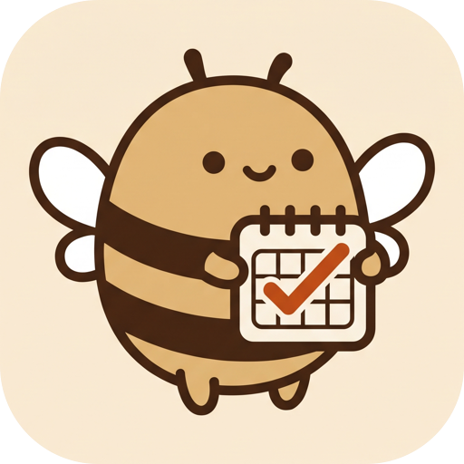
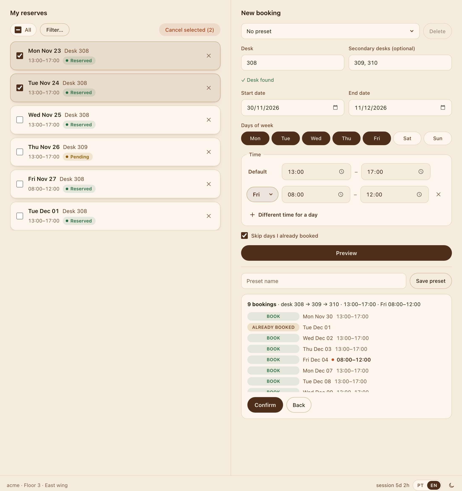
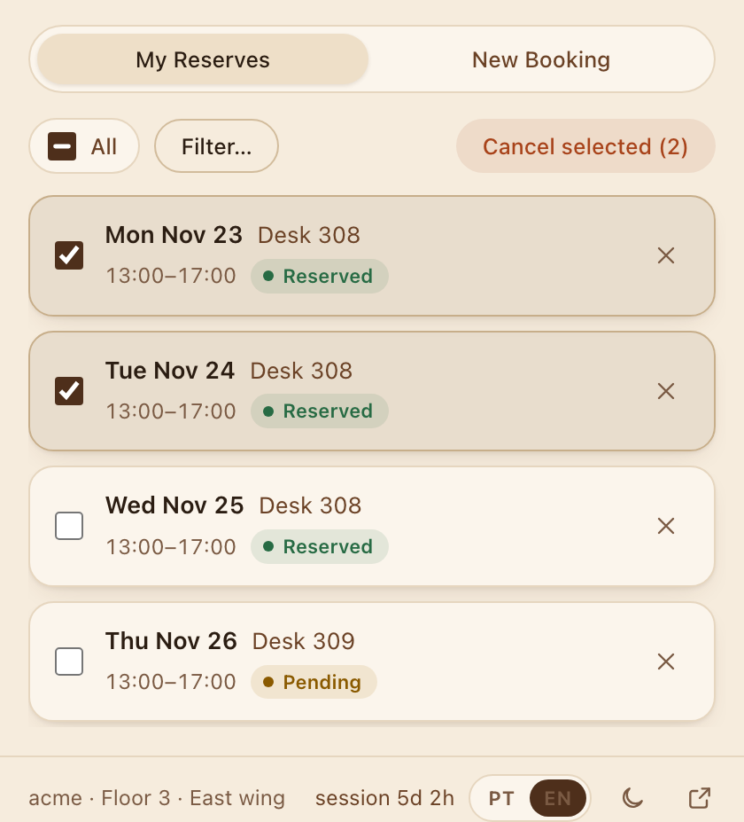
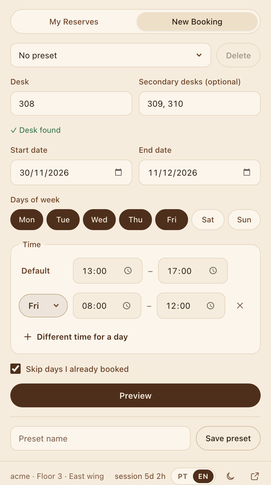
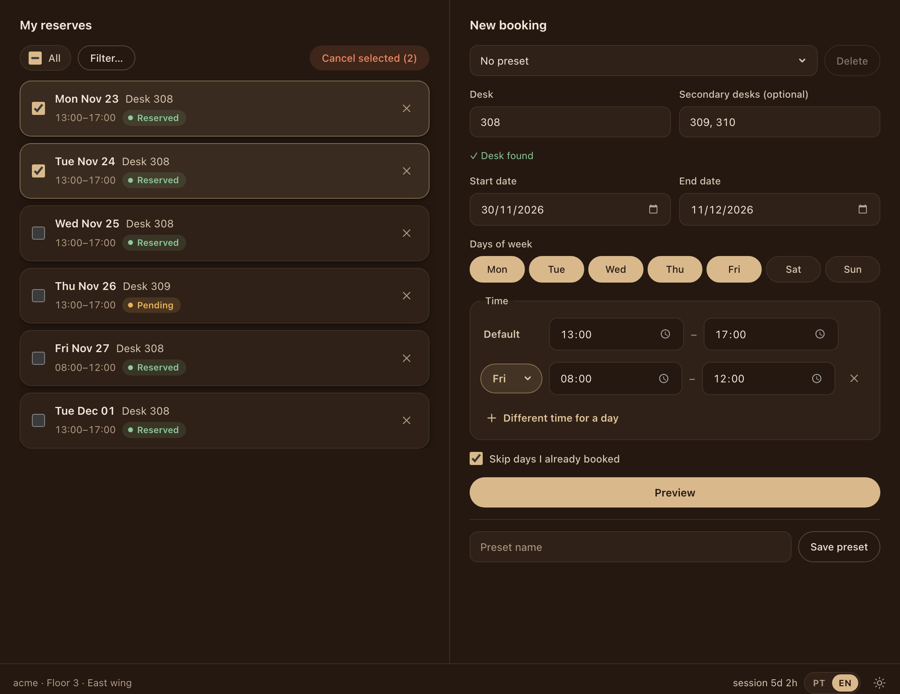
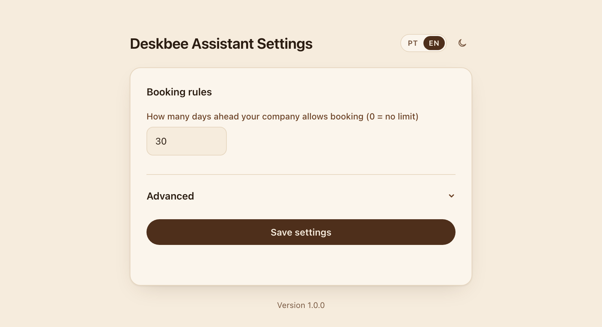

<p align="center">
  
</p>

<h1 align="center">Deskbee Helper</h1>

<p align="center">
  A Chrome extension that books and cancels Deskbee workstations in batches —
  plan the whole month in a few clicks, for any company's Deskbee.
</p>

<p align="center">
  <a href="https://github.com/agvmdsa/DeskbeeHelper/releases/latest"></a>
</p>

<p align="center">
  <sub>Chrome, Edge and Brave · <a href="#installation">how to install</a></sub>
</p>

<p align="center">
  <a href="#-português">🇧🇷 Português</a> · <a href="#-english">🇺🇸 English</a>
</p>

<div align="center">



<details>
  <summary>More screenshots</summary>
  <br />
  <table align="center">
    <tr>
      <td align="center"><br /><sub>Select and cancel reserves in batch</sub></td>
      <td align="center"><br /><sub>Book a range with a different time per day</sub></td>
    </tr>
  </table>
  <br />
  <br />
  <sub>Dark theme · side-by-side layout in a detached window</sub>
  <br /><br />
  <br />
  <sub>Options: booking window and detected company, floor and app version</sub>
</details>

</div>

## 🇧🇷 Português

Extensão para Chrome que reserva e cancela estações de trabalho do [Deskbee](https://deskbee.io) em lote. Você monta o mês inteiro em poucos cliques, sem precisar marcar dia por dia.

Funciona com o Deskbee de qualquer empresa (`<empresa>.deskbee.app`).

### Funcionalidades

- **Reserva em lote**: baia, período, dias da semana e horário padrão, com **horário diferente por dia** (ex.: sexta 08:00–12:00).
- **Prévia antes de confirmar**: mostra o que será reservado e pula dias já reservados e datas além do limite de antecedência da empresa.
- **Baias secundárias**: se a baia principal estiver ocupada num dia, tenta as próximas na ordem.
- **Predefinições**: salve uma configuração de reserva com um nome e reuse depois.
- **Cancelamento em lote**: cancele uma reserva ou selecione várias, inclusive por filtro de data, dia da semana e baia.
- **Janela separada**, com as reservas e o formulário lado a lado em telas largas.
- **Tema claro/escuro** e **português/inglês**.

### Instalação

1. Clique em **Download extension** acima (ou abra a [última release](https://github.com/agvmdsa/DeskbeeHelper/releases/latest)), baixe `DeskbeeHelper-vX.Y.Z.zip` e descompacte. Ou clone este repositório.
2. Abra `chrome://extensions` e ative o **Modo do desenvolvedor**.
3. Clique em **Carregar sem compactação** e selecione a pasta da extensão.

Também funciona em outros navegadores baseados em Chromium (Edge, Brave, Arc…).

### Primeiro uso

1. Abra o Deskbee da sua empresa (`https://<empresa>.deskbee.app`) e faça login.
2. Pronto: a extensão detecta a empresa e a sessão automaticamente. O andar vem das suas reservas ou do mapa, na primeira vez que você o abrir.

A sessão do Deskbee dura cerca de 7 dias. Quando ela expirar, basta abrir o site uma vez para a extensão pegar a nova. O limite de antecedência e, se precisar, a empresa e o andar podem ser ajustados nas **Opções** da extensão.

### Atualizações

A extensão verifica uma vez por dia se há uma versão nova em [Releases](https://github.com/agvmdsa/DeskbeeHelper/releases/latest). Quando houver, aparece um aviso no popup e um selo no ícone. Também dá para verificar na hora em **Opções → Atualizações**.

Para atualizar, baixe o `.zip` e **descompacte por cima da mesma pasta**, depois clique em ↻ em `chrome://extensions`. Usar a mesma pasta mantém suas predefinições e configurações.

### Privacidade

- Tudo fica no seu navegador (`chrome.storage.local`). Não há servidor próprio.
- A extensão só se comunica com `api.deskbee.io` e, uma vez por dia, com a API do GitHub para ver se há atualização.
- Ela só roda nas páginas `*.deskbee.app`.

### Desenvolvimento

Requer Node 22+.

```sh
npm test        # testes (planejamento de datas, filtros, horários, traduções)
npm run check   # sintaxe, manifest, imports de CSS e versão
npm run build   # gera dist/DeskbeeHelper-v<versão>.zip
```

Para publicar uma versão: atualize `version` no `manifest.json`, adicione a entrada no topo do `changelog.md` e envie uma tag `vX.Y.Z`. O workflow de release gera o `.zip` e publica em Releases.

### Licença

[MIT](LICENSE): uso, cópia, modificação e distribuição livres, inclusive dentro de empresas, mantendo o aviso de copyright.

### Créditos

A ideia e a primeira versão são do meu amigo [Filipe](https://github.com/filipe-ms), que criou a extensão para facilitar a nossa vida marcando a baia em vários dias de uma vez só. A partir dela, fui implementando funcionalidades e deixando tudo mais prático conforme víamos necessidade.

> Projeto independente, sem vínculo com o Deskbee. Use de acordo com as regras de reserva da sua empresa.

---

## 🇺🇸 English

Chrome extension that books and cancels [Deskbee](https://deskbee.io) workstations in batches. Plan the whole month in a few clicks instead of booking day by day.

Works with any company's Deskbee (`<company>.deskbee.app`).

### Features

- **Batch booking**: desk, date range, weekdays and a default time, with **a different time per day** (e.g. Friday 08:00–12:00).
- **Preview before confirming**: shows what will be booked and skips days you already booked and dates beyond your company's booking window.
- **Secondary desks**: if the main desk is taken on a day, the next ones are tried in order.
- **Presets**: save a booking setup under a name and reuse it.
- **Batch canceling**: cancel one reserve or select several, also by date, weekday and desk filter.
- **Detached window**, with reserves and the booking form side by side on wide screens.
- **Light/dark theme** and **Portuguese/English**.

### Installation

1. Click **Download extension** above (or open the [latest release](https://github.com/agvmdsa/DeskbeeHelper/releases/latest)), download `DeskbeeHelper-vX.Y.Z.zip` and unzip it. Or clone this repository.
2. Open `chrome://extensions` and enable **Developer mode**.
3. Click **Load unpacked** and select the extension folder.

Also works in other Chromium-based browsers (Edge, Brave, Arc…).

### First use

1. Open your company's Deskbee (`https://<company>.deskbee.app`) and log in.
2. That's it: the extension detects your company and session automatically. The floor comes from your bookings, or from the map the first time you open it.

A Deskbee session lasts about 7 days. When it expires, open the site once and the extension picks up the new one. The booking window and, if needed, the company and floor can be adjusted in the extension's **Options**.

### Updates

The extension checks once a day for a new version on [Releases](https://github.com/agvmdsa/DeskbeeHelper/releases/latest). When there is one, the popup shows a notice and the icon gets a badge. You can also check right away in **Options → Updates**.

To update, download the `.zip` and **unzip it over the same folder**, then click ↻ in `chrome://extensions`. Keeping the same folder keeps your presets and settings.

### Privacy

- Everything stays in your browser (`chrome.storage.local`). There is no server of its own.
- The extension only talks to `api.deskbee.io` and, once a day, to the GitHub API to check for updates.
- It only runs on `*.deskbee.app` pages.

### Development

Requires Node 22+.

```sh
npm test        # tests (date planning, filters, schedules, translations)
npm run check   # syntax, manifest, CSS imports and version
npm run build   # builds dist/DeskbeeHelper-v<version>.zip
```

To release: bump `version` in `manifest.json`, add an entry at the top of `changelog.md` and push a `vX.Y.Z` tag. The release workflow builds the `.zip` and publishes it on Releases.

### License

[MIT](LICENSE): free to use, copy, modify and distribute, including inside companies, as long as the copyright notice is kept.

### Credits

The idea and the first version came from my friend [Filipe](https://github.com/filipe-ms), who built the extension to make our lives easier by booking our desk for many days at once. From there, I kept adding features and making it more practical as we saw the need.

> Independent project, not affiliated with Deskbee. Use it according to your company's booking rules.
